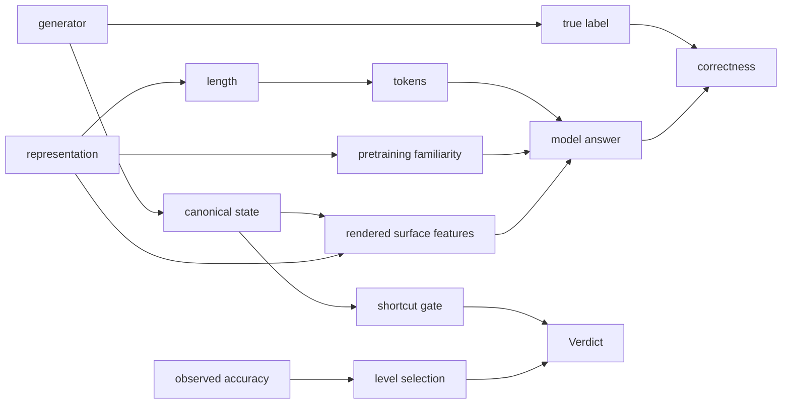

# V7 Total Forensic Audit

**Method.** Nine independent auditors, each briefed to *destroy* the experimental argument rather
than defend it, plus integrator verification of every load-bearing claim. Zero model calls, laptop
only. Every number below was recomputed from source or artifact; the commands are in
`research/audit/`.

**Reproduction status.** The DEV probe bank rebuilds bit-exact (`dev_pool_hash = f804e0d9…`,
matching the frozen artifact) and **V7's entire verdict recomputes from the 864 stored rows with no
`arena` import — 252 checks, 0 mismatches**. Nothing here disputes V7's arithmetic.

---

## 1. Executive verdict

**The representation hypothesis has not failed. It has never been tested.**

In the whole V1→V7 programme, **no experiment has ever scored two representations against a
Solver.** V7's 864 rows all carry one `candidate_id` (`V5E_L3_JSON_AST`). V4's frozen manifest lists
an 8-founder roster with `probes: []`. The 120 mutants appear only in a deterministic Gate-0
structural check. `Δ = Acc(R_A) − Acc(R_B)` has been computed **once in programme history** (V3),
where it was ruled invalid for ceiling/floor.

V7 is a **task-usability pre-test conducted through a single fixed representation**, whose verdict
is being consumed downstream as evidence about R. Its three sub-verdicts do not share a fate:

| mechanism | V7 verdict | audit finding |
|---|---|---|
| `formal_expression_depth` | `VOID_SHORTCUT` | **Correctly voided — for a weaker reason than the true one.** Unrescuable |
| `transitive_dependency` | `VOID_SHORTCUT` | **Not supported.** One row from qualifying; comparator is a selection artifact below its own null mean |
| `precondition_conjunction` | `VOID_CEILING` | **Correct, and the most valuable finding in the run** — it is balanced by construction |

The operational decision (do not spend the founder-tournament budget) was defensible. The
scientific claim encoded in the sentinel `V7_SHORTCUT_DOMINATED` is not supported.

---

## 2. What V7 actually established

Derived from code, not prose. `qualify_mechanism` (`fitness_v7.py:714-771`) computes **no test
statistic and no p-value**; it returns PASS/void strings. The operative hypothesis is a conjunctive
admissibility screen:

> **H0(m):** at the accuracy-selected level ℓ\* = argmin|Acc−0.775| over ℓ∈{1,2,3}, the **single**
> control genome `V5E_L3_JSON_AST`, rendered to `qwen38-rvn` at T=0, fails ≥1 of ten conditions.
> **H0(instrument):** fewer than 2 of 3 reject.

**The symbol `R` appears nowhere in H0 or H1.** "Zero qualified mechanisms" is therefore *not*
equivalent to "representation fitness does not exist"; the justified conclusion is narrower: *three
particular synthetic probe families, read through one serialisation by one solver at n=24, did not
clear a ten-part admissibility screen.*

`GOAL.md` contains **no** shortcut threshold and no "beat every shortcut by 10 points" requirement
(`grep` returns two incidental mentions, lines 455 and 887). The rule is instrument-local.

---

## 3. Confirmed flaws

**C1 — The shortcut audit reads a string the Solver never receives. CRITICAL, BOTH.**
`shortcut_audit` scores rules on `canonical_json(probe.state.to_dict(...))`
(`fitness_v5.py:798-799`); the Solver receives `build_prompt` (`:550-565`), whose state block is the
**rendered** surface. `canonical_json` sorts keys so `goal` precedes `objects`; the renderers emit a
sorted, answer-independent `objects` block first. Measured by the integrator
(`research/audit/integrator/verify_audited_string.py`):

| mechanism | L | `first_mentioned` on canonical JSON | on rendered prompt |
|---|---|---|---|
| `formal_expression_depth` | 1 | **1.0000** | **0.5000** |
| `formal_expression_depth` | 2 | **0.8333** | **0.5000** |
| `formal_expression_depth` | 3 | 0.9167 | **0.5000** |
| `transitive_dependency` | 3 | 0.3333 | **0.5000** |

The rule that produced **both** `VOID_SHORTCUT` verdicts is at exact chance on the real input.
Three auditors reached this independently with identical corrected margins (+0.1250, +0.2083).

**C2 — But `formal_expression_depth` is solvable at 1.000 on the rendered prompt anyway, on every
surface. CRITICAL, and it is the deeper truth.** Under any lossless bracketed serialisation, "max
AST depth" *is* "max delimiter balance". Integrator-verified bracket-depth counter on the rendered
`L3_JSON_AST` prompt: **24/24 = 1.0000 at L0, L1, L2 and L3**; auditor 2 replicates across all eight
surfaces spanning a 4.4× length range. **The optimal strategy is representation-invariant, so a
Game-R tournament on this mechanism could never have detected a representation effect.** The leak
is intrinsic, not generated: in the donor domain deepest == first in **79.3%** of states
(mean ρ = −0.781). Not fixable by regenerating probes.

**C3 — `transitive_dependency`'s void is unsupported. CRITICAL, FALSE_NEGATIVE.**
`best_shortcut` is `max` over 7 rules × 2 polarities scored on the *same* 24 items. Under a null
with no signal, `E[best] = 0.659–0.723` and `P(best ≥ 0.6667 | null) = 0.914`. The observed 0.6667
is **below the clustered null mean**; the winning rule scores 0.3333 raw — *anti*-correlated — and
0.6667 is its post-hoc negation. McNemar exact **p = 0.625** on 4 discordant pairs, net 2 items.
The mechanism is **one row** from qualifying (18/24, needs 19); P(QUALIFIED) under resampling
**0.316**.

**C4 — The 0.10 threshold is unrepresentable at n=24. CRITICAL.** Margins are `k/24`, so achievable
values bracket 0.10 at 0.0833 and 0.125: **the executed gate is 0.125, 25% stricter than declared**,
undisclosed. `transitive_dependency` landed exactly 0.40 of one quantum short. Power to distinguish
.083 from .10 is **0.069**. To classify a true 0.08 against a 0.10 gate needs ≈**4,000** items;
V7 ran 24.

**C5 — Both 0.083 and 0.10 lie inside the project's own equivalence region.** `fitness_v5.py:248-249`
declares `practical_equivalence_region = 0.125` and `smallest_effect_of_interest = 0.15`.

**C6 — The real failure mode is position anchoring, and the gates cannot see it. HIGH.**
Of 69 wrong rows: **56.5% are position anchoring** (same letter to a probe and its option-swapped
twin), 95.2% of them "A"; destroyed twins — zero information by construction — draw "A" 69.4% of the
time. Meanwhile `position_invariance_min = 0.50` is set **at chance**, and the selected
`formal_expression_depth` L2 passes it at 0.583 (41.7% of pairs answered by position).
`shortcut_audit` scores `always_first_option` against a *balanced key*, capping it at ≈0.54
regardless of solver behaviour. **Wrong answers are anti-correlated with `first_mentioned`** (85.2%
accurate where the model errs vs 66.3% where it is right) — the model is *not* following the gated
cue.

**C7 — `relabel()`'s counterfactual is blind to exactly the rules that matter. CRITICAL.**
`cf_blindness = 1.000` for every order/position/frequency/depth rule and 0.000 for the rest — no
power in between. Its docstring claim (`formal_structural.py:184-186`) that "a model that reads
surface statistics cannot [flip]" is **refuted by measurement**: names swap in place, so
per-identifier statistics flip *with* the label.

**C8 — 67% of V7's probes are synthetic but stamped as formal. HIGH, HYGIENE→scope.**
`DONOR_ROOT` is HML_V3, **not LeanDojo**. Only `formal_expression_depth` uses real Lean states;
the other two pass `formal=None`. 576 of 864 probes are synthesised, all labelled
`arena-formal-structural-v1.0.0`.

**C9 — V5's only pre-run shortcut safeguard pooled across mechanisms and levels.**
`fitness_v5.py:1184` pooled all 864 probes → `more_frequent_in_state 0.7153 CLEAN`. That is the
"0.72" cited at `FITNESS_V5_SPEC.md:89` as the spec's sole shortcut defence. **Pooling diluted a
1.000 leak into a pass, and named the wrong rule.** Compounded by `verdict = failures[0]` (`:984`)
with `shortcut` last in the dict — masking rate 2/2.

**C10 — The seal under-declares exposure by 60%, and the promotion pool is spent. HIGH.**
`SEALED_SPLITS.json` labels `novel_premises/{val,test}` clean `PROMOTION_OOD`. They had already been
parsed by committed scripts — `premise_selection_shortcuts.json` reports **3,586 novel_premises
items** across six distractor policies × eight heuristics — **5h16m before the seal was written**.
Real exposure **21,632 steps vs 8,766 declared**. Worse, the *shipped* distractor tiers are the
*measured* policies: contamination is **design-level**. `steps.jsonl` (271 MB, unsealed) carries
val/test theorem names, paths, line spans and premise names for all 259,580 rows.
**This refutes my own ledger claim at `PROJECT_LEDGER.md:747` that splits were "sealed before any
agent was spawned."**

---

## 4. Likely flaws

**L1 — Selection and qualification share the same 24 rows** (`fitness_v7.py:1024→1063→1092`);
`arm_schedule: "full"`, so nothing is measured after selection. V3 had an independent SCOUT pool;
V4 dropped it. Point bias is small (argmin pulls from both sides) but level choice flips **55.4%**
under resampling for `formal_expression_depth`.

**L2 — V7 adopted the midpoint selector but omitted the paired gap calibration** measured in-repo
*before* V7 (`v5_selector_analysis.json` §3/§5), tripling the no-true-in-window qualification rate
0.081→0.262, above the 0.170 oracle ceiling.

**L3 — Levels confound difficulty with length.** ρ(level, real prompt tokens) = **+1.0** and
ρ(accuracy, tokens) = **−1.0** for both leaking mechanisms. Accuracy-versus-level cannot be read as
a reasoning-difficulty curve. (Confound CONFIRMED; length-as-cause remains HYPOTHESIS — 3 levels
give permutation p = 1/6.)

**L4 — Effective n is 14.9, below the instrument's own `min_positives_for_gates = 24`.**
Every cell is 12 families × 2 items (ORIGINAL + its COUNTERFACTUAL, maximally dependent).
ICC +0.511, design effect 1.61. Nine of twelve families contribute nothing to the decision cell.

---

## 5. Refuted suspected flaws — where the instrument holds

- **The arithmetic.** 252 independent checks, 0 mismatches. Bit-exact probe bank, 804/804 surviving
  cache entries corroborate, 0 orphans.
- **Preregistration discipline.** Spec committed at `e66bab1` before the first call; deterministic
  selector; nothing moved after; the explicit refusal to drop to 0.08 is correct and is endorsed.
- **The derived frontier target** ((0.50+0.20+0.85)/2 = 0.775) is arithmetically correct, and
  `DESTROYED_EXPECTED = 0.50` is empirically confirmed 144/144.
- **Labels are not string-generated.** All three truths re-derive from the canonical object and
  reproduce 96/96.
- **Closeness-to-target does not select strong shortcuts.** Exact enumeration over all 27
  level-triples: V7's picks mean shortcut 0.667 vs uniform-random 0.708, one-sided p = 0.889.
- **No cache row was lost, changed or replayed.** True loss 60 rows + 8 Q0 = 68, all in one cell at
  the head of the run; 804+60 = 864, 864+8 = 872. All rows `FRESH`.
- **872 vs 864 explained exactly:** `planned_call_count` adds 8 Q0 calls, reported separately.
- **No context loss, no format failure.** Max 7,960 / 32,768 tokens; `completion_tokens == 6` on all
  864 rows under grammar constraint.
- **Tests cannot touch live cache** (all `tmp_path`; the suite actively asserts `SealedSplitError`).

---

## 6–12. Sub-audits

Full reports: `research/audit/a1…a9`. Construct validity (§6) is in C2/L3; the shortcut-audit audit
(§7) in C1/C3/C7; statistics and power (§8) in C3/C4/L4; selector (§9) in L1/L2; solver (§10) in C6;
leakage (§11) in C10; hygiene (§12) in §5.

**Solver, specifically:** no multi-seed run exists anywhere in the programme. Determinism is
asserted from T=0 and from 144/144 identical twin pairs, never from a re-run. 8 of 12 cells sit at
≥0.958 — the solver is too capable for this ladder, which is a *difficulty* finding, not a solver
defect.

---

## 13. Phase-6 retrospective

Exactly **one** gate separates Phase 6's single qualification from V7's zero: `shortcut_margin`,
which does not exist in V5. Same level, same accuracy, same shortcut value.

Phase 6 was **not wrong** — it applied its frozen rule correctly, and V7 reproduced every ladder
value exactly from 864 fresh calls, which **retrospectively neutralises the 61 contested cache rows
for every qwen number**. Its sentinel was *weaker than warranted* and its §11 **reported a
counterfactual it had not measured** — the refuting number (0.833 at that stratum) had been
published 9h18m earlier in `FITNESS_V5_RESULT.md:69-72`.

Its validity table's "cache hits = 0" was **asserted, not measured**: `run_development` computes
`cache_hits` and never writes it. *The invalidation rule keyed on a quantity the pipeline never
recorded.*

**The generalisable failure is not "untested counterfactual" but GRANULARITY SUBSTITUTION** — a
statistic computed on a coarser population than the claim drawn from it. It recurs in the V5 spec
(pooled shortcut audit), in Route B (loss ranking, split seed, `verified` metric) and in Phase 6.
Six such claims are refuted at HIGH severity; **one is still live** as the programme's stated next
action at `GAME_R_STATUS.md:85`.

**Enforcement rule R-K1 (specified, not implemented):** no document may assert a cell would qualify
unless every gate was evaluated on that exact cell. Mechanise via a frozen `GatedCell` type that
raises unless `gates_evaluated == full gate set`, with `qualified` a computed property — so a cell
scored on a subset **cannot be represented at all**.

---

## 14–15. The real-Lean route and the Astra bridge — the proposal falsifies too

Astra's every claim replays byte-identically. Formally it proves **(P1)**: each codec factors
through the source projection and is injective on its image. Semantic parity needs **(P2)**: the
projection is a sufficient statistic for the truth function. **(P1) ⇏ (P2), and (P2) is refuted:**
19/300 states carry elided `⋯` subterms, 247/300 inaccessible `✝` names, and **341/1,800 candidate
statements (18.9%) are not closed propositions**.

**The decisive falsifier — cheap, already written.** *E1: no ≥40-char span of the Lean pretty text
may appear in more than one arm.* **Astra's codecs fail 300/300 × 5/5** — context, goal, all six
names and all six statements appear **byte-verbatim** in every arm; four of five are 91–98%
identical `canonical_json` behind a different line prefix. They are five envelopes around one
string. **Any arm set failing E1 is not a Game-R arm set.**

Astra's 0.4167 holdout figure is also inconsistent with production: the same rule on the same
sampler scores **0.2420 on 17,513 items** (z = 3.151, p = 0.0016). Wilson CI at n=60 is
[0.301, 0.543] — width 0.242.

**Nothing here refutes a claim Astra makes** — its own handoff states the semantic gap. The exposure
is that "source-projection parity" is one adjective away from being read as the thing the programme
needs.

**The constructive finding:** `HML_V3/data/corpus/lean_runtime_v2_full.canonical.part-*` **already
contains the elaborated object** — 1,150 transitions with `identity ⟂ display_name`, four binder
roles, Level trees, `external_premise_refs`, transitive imports on 1,150/1,150. Only **190** are
single-premise/single-goal. **Scale, not method, is the gap.** Matching the string family's 63,831
items would need ≈199,000 replays at the historical 32/100 yield.

---

## 16. Causal DAG

**Blocked by V7:** option position (balanced key pins four rules at 0.5000 in all 12 cells);
the destroyed control (0.5000 measured everywhere — the theorem holds); solver and cache identity.

**Open:** `Gen→Srend→Ans` with `Gen→Ytrue` (generation-time confound, the live one) ·
`R→Srend→Ans` (**never measured — the path the gate intends to police**) · `R→Len→Tok→Ans` ·
`R→Fam→Ans` (wide open; `GOAL.md` §14 names it) · `Y→Sel→Verdict` (selection) ·
position sensitivity (gated at chance).

**The structural fact:** `Xcanon` — the node V7 gates on — has **no outgoing edge to `Ans`**. It is
d-separated from the solver. The node on the actual cue-following path, `Srend`, is measured
nowhere.

---

## 17–18. Risk directions

**False-positive risk (over-voiding good tasks):** the max-over-family comparator without
selection correction (C3); auditing an unseen serialisation (C1); a blind counterfactual (C7); a
balanced destroyed arm that a perfect bracket-counter passes.

**False-negative risk (admitting bad tasks):** only 2 of 7 shortcut rules are ever live — five are
exactly 0.5000 in all 12 cells; the rendered prompt is **never** audited, and carries
`last_mentioned` at 0.9167 (negated) at the selected cell; position anchoring is invisible by
construction; **the cue is representation-dependent** (0.833–1.000 in `L5_COMPACT_SYMBOLIC` and
`L6_GRAPH_TRIPLES` vs 0.500 in `L3_JSON_AST`) — so a founder tournament would have compared
surfaces with *unequal cue availability*.

---

## 19–20. Historical conclusions

**Remain valid:** V1's position-only invalidation · V3's pooling lesson (directly vindicated — V5
repeated it one layer down) · V5's sentinel and its exemplary manual disclosure of the masked
co-failure · Phase 6's **solver** finding (strengthened by V7's clean replication) ·
`formal_expression_depth`'s void · `precondition_conjunction`'s `VOID_CEILING` · V7's arithmetic ·
`RSTAR_NOT_IDENTIFIED`.

**Downgraded or void:** Phase-6 §11 in full, and its still-live restatement at
`GAME_R_STATUS.md:85` · Phase 6's "cache hits = 0" row (asserted, not measured) · V5 spec §4's
shortcut safeguard (pooled, wrong rule) · `transitive_dependency`'s `VOID_SHORTCUT` (unsupported) ·
the sentence "the instrument is sound; the mechanisms are not" in `FITNESS_V7_RESULT.md` §2 ·
Route B's loss ranking, seed randomisation and `verified` metric · World-v0 `NEXT_ACTION` as a
learning substrate · `SEALED_SPLITS.json`'s `PROMOTION_OOD` label on `novel_premises` · my own
ledger claim that sealing preceded all agent reads.

---

## 21. Probability-weighted diagnosis

| | | P |
|---|---|---|
| **A** | Representation hypothesis unsupported; landscape genuinely flat | **0.02** |
| **B** | V7 mechanisms are poor instruments / confounded; hypothesis untested | **0.88** |
| **C** | Mixed | **0.10** |

**A is near-vacuous by construction:** no evidence bears on it, because Δ has never been computed
on a valid instrument. The 0.02 is the residual probability that the hypothesis is false *and* we
would have been unlucky enough to see exactly this.

**B carries the mass** on: zero representations varied; one mechanism representation-invariantly
solvable at 1.000; one void resting on a comparator below its own null mean at power 0.069; the
audited string differing from the solver's input; 67% synthetic probes; the dominant error mode
invisible to the gates.

**C's 0.10** is real and should not be rounded away: `formal_expression_depth`'s leak is
**intrinsic to real Lean terms** (deepest == first in 79.3% of donor states), not merely generated —
a genuine fact about the domain. And the ceiling on `precondition_conjunction` is a real fact about
this solver.

---

## 22. Exactly ONE next experiment

**`PC-EXTENDED FOUNDER PILOT` — extend `precondition_conjunction` upward until the control lands in
the qualifying band, then run the programme's first founder tournament on it.**

Not a V8: it changes **D** (difficulty), which is the frozen variable class V7's own
`VOID_CEILING` names — the admissible reason for a new development ladder.

**Why this mechanism.** It is the only one that is clean, and it is clean **by construction**, which
I verified in source: `_premise_family` (`fitness_v4.py:762-800`) builds `objects` and `propositions`
**once** and passes them unchanged to original, counterfactual and destroyed; only
`assumptions=held(...)` varies. The answer identifiers never move. Measured consequence: canonical
invariant **12/12** families in every level (vs 0/12, with 12/12 *swapped*, for the other two), and
best shortcut **exactly 0.500** at L1–L3. It failed on ceiling alone.

**Why it answers the real question.** `GOAL.md` asks whether **∃R** such that
`Capability(M|R) > Capability(M|R_control)`. That is an *existence* claim. A clean synthetic
mechanism with headroom can answer it — and would compute **Δ for the first time in programme
history**. If no effect appears where the model has room and the cues are provably at chance, that
is real evidence. If one appears, *then* the expensive Lean canonicalisation is justified by a
result rather than a hope.

**Preconditions, all preregistered before any call.** Recalibrate the ladder on development data
only until control accuracy ∈ [0.70, 0.85] (PC's premise count already scales 2/3/5 → extend to
7/9). Then, at **zero model cost**: shortcut audit **on the rendered prompt, per representation**
(C1, and the representation-dependence in §18 makes per-arm mandatory); **E1** — no ≥40-char span
shared across arms; score `always_first_option` against the **model's answers**, not the key (C6);
independent selection and qualification pools (L1); and n sized for the decision, not 24 (C4).

**Falsification attempt, stated honestly.** The strongest objection is that PC is *synthetic*
(`formal=None`), so an effect there may not generalise to real mathematics. That is a limit on
**generalisation**, not on **validity** — and it is the correct order of operations: establish
existence on the cheapest clean instrument before spending ≈199,000 Lean replays. The second
objection is that extending difficulty may introduce new cues; that is exactly what the per-arm
rendered-prompt audit and E1 are there to catch, and PC's generator makes cue-invariance
structural rather than incidental.

**Explicitly rejected as the next step:** real-Lean premise selection in its current form — it
fails E1 at 300/300 × 5/5, its promotion pool is spent at design level, and only 190 elaborated
transitions are usable. It remains the right *second* step, and the elaborated object it needs
already exists locally.

---

**V7_PARTIALLY_VALID_INSTRUMENT_CONFOUNDED**
