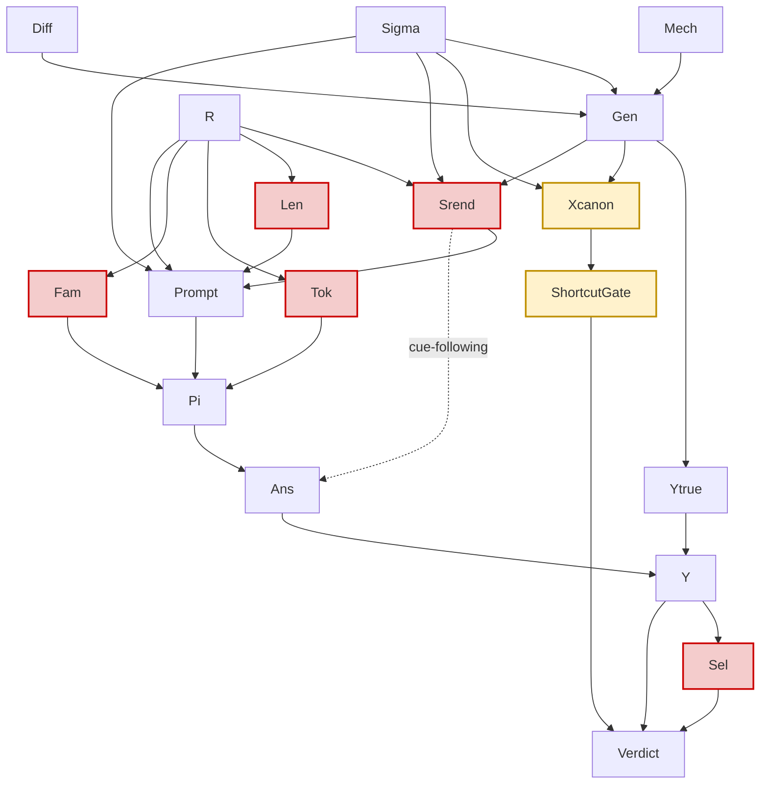

# A1 — What V7 Actually Established, and the Conceptual Core

**Auditor 1 of 9 · Total forensic audit of Fitness V7 · READ-ONLY**

Scope: audit Parts A (what V7 tests), N (shortcut-resistance vs beat-the-shortcut), O (ordering and
the causal DAG). No model call was made. No existing file was modified. No V7 artifact was
re-scored, rewritten or re-run. Every number below is either read from the frozen artifact or
computed from the probe bank with zero model calls.

Environment verified before any measurement:

```
$ /Users/moheet/Documents/ChatGPT/hamiltonian_chess/.venv/bin/python \
    -c "import arena; print(arena.__file__)"
/Users/moheet/Documents/ChatGPT/hamiltonian_chess/.claude/worktrees/phase-6-parallel-setup-9c6068/arena/__init__.py
```

All later commands set
`PYTHONPATH=/Users/moheet/Documents/ChatGPT/hamiltonian_chess/.claude/worktrees/phase-6-parallel-setup-9c6068`
and re-verify that `arena.experiments.fitness_v5.__file__` resolves inside the worktree.

Primary artifact:
`artifacts/experiments/fitness_v7/development/result-qwen38-rvn_latest-bare.json`
(1,393,126 bytes; `mode = LIVE`; 864 rows; `cache_scope_totals = {"FRESH": 864}`;
`dev_pool_hash = f804e0d998f1cfac20559728cae29733602990ed801430c1398db798b84a9c8b`).

---

## 0. Executive verdict

**The measurement system is wrong, on an identifiable and reproducible axis — and the wrongness is
outcome-determining.**

The single load-bearing finding of this audit:

> V7's shortcut audit is computed on `canonical_json(probe.state.to_dict(...))`
> (`arena/experiments/fitness_v5.py:798-799`), **not** on the prompt the solver receives
> (`arena/experiments/fitness_v5.py:550-565`). The two strings order their content differently.
> In the string the solver actually reads, the rule that produced **both** `VOID_SHORTCUT`
> verdicts — `first_mentioned_in_state` — scores **exactly 0.5000 (chance) in all twelve
> mechanism × level cells**. Re-running the identical 7-rule audit on the rendered prompt yields
> `best_shortcut_accuracy` of 0.6667 for `formal_expression_depth` L2 and 0.5417 for
> `transitive_dependency` L3. Both then pass `shortcut_absolute` **and** `shortcut_margin`. Since
> the artifact records that *every other gate already passed on both cells*
> (`all_failures = ["shortcut_absolute","shortcut_margin"]` and `["shortcut_margin"]`
> respectively), both mechanisms would have **QUALIFIED**, giving 2 of 3 and
> `founder_tournament_authorized = true`.

This does **not** mean the correct answer is "2 of 3". Auditing the rendered *state section only*
(excluding options and the syntax guide) exposes a different, unaudited cue —
`last_mentioned_in_state` at raw 0.0833, i.e. 0.9167 once negated — which voids
`formal_expression_depth` L2 again. **The verdict is a function of an unregistered, undocumented
implementation choice about which string the rules are applied to.** That is the finding: V7's
headline result is not robust to a decision its own preregistration never made.

Everything else in this report supports, qualifies or refutes that conclusion.

---

## PART A — What V7 tests

### A1. The precise null and alternative, derived from code

V7 computes no test statistic, no p-value and no error rate. `qualify_mechanism`
(`arena/experiments/fitness_v7.py:714-771`) returns a dict of `"PASS"`/void strings. What V7
actually implements is a **conjunctive admissibility screen**, so its "hypothesis" must be stated
as a screening rule, not as a statistical null.

For each mechanism *m* ∈ {`formal_expression_depth`, `transitive_dependency`,
`precondition_conjunction`}:

1. **Selection** (`fitness_v7.py:677-712`). Let `Acc_m(ℓ)` be the accuracy of the **single control
   genome `V5E_L3_JSON_AST`** on the 24 positive probes at level ℓ. Select
   ℓ\* = argmin over ℓ ∈ {1,2,3} of |Acc_m(ℓ) − 0.775|, ties to the lower level, provided
   `Acc_m(0) ≥ 0.90`, `0.35 ≤ Acc_m(ℓ*) ≤ 0.85`.
2. **Gating** (`fitness_v7.py:727-756`). *m* is `QUALIFIED` iff **all ten** hold at ℓ\*:

| # | Check | Condition | Source |
|---|---|---|---|
| 1 | `q0` | Q0 valid rate ≥ 0.95 | `fitness_v5.py:216` |
| 2 | `valid_response` | valid ≥ 0.95 | `:217` |
| 3 | `context` | truncated rows = 0 | `:218` |
| 4 | `sample_size` | positives ≥ 24 | `:224` |
| 5 | `negative_collapse` | Acc − Acc_destroyed ≥ 0.20 ⇔ **Acc ≥ 0.70** (destroyed ≡ 0.5000) | `:219` |
| 6 | *(band)* | Acc ≤ 0.85 | `:214` via selection |
| 7 | `answer_share` | largest answer share ≤ 0.75 | `:222` |
| 8 | `position_invariance` | ≥ 0.50 | `:227` |
| 9 | `shortcut_absolute` | `worst_score` ≤ 0.75 | `:228` |
| 10 | `shortcut_margin` | Acc − `worst_score` ≥ 0.10 − 1e-9 | `fitness_v7.py:175, 754` |

3. **Instrument rule** (`fitness_v7.py:1172-1173`): `instrument_qualified = |{m : QUALIFIED}| ≥ 2`
   (`minimum_qualified_mechanisms = 2`, `fitness_v5.py:226`).

**H0 (per mechanism), stated exactly as the code tests it.** *At the accuracy-selected level, the
control surface `V5E_L3_JSON_AST` rendered to `qwen38-rvn:latest` under bare, grammar-constrained,
temperature-0 decoding fails at least one of the ten conditions above.*

**H1.** *All ten hold.*

**H0 (instrument).** *Fewer than two of the three mechanisms reject their H0.*

Two properties of this null are decisive and are not stated in
`docs/FITNESS_V7_PREREGISTRATION.md`:

- **The symbol `R` does not appear in H0 or H1.** The genome is a fixed constant
  (`fitness_v7.py:946`).
- **Condition 9 and 10 quantify over a string the solver never receives** (§N4).

### A2. What is V7 actually measuring? (`qualify_mechanism` + gates)

Decomposing the ten checks by the object each one constrains:

| Object constrained | Checks |
|---|---|
| Response-protocol integrity (C/B, not D or R) | 1, 2, 3, 4 |
| **Joint** solver capability × task difficulty — inseparable, one solver, one surface | 5, 6 |
| Degenerate answering strategies | 7, 8 |
| Shortcut resistance **of the canonical-state serialization** | 9, 10 |
| Representation quality | *(none)* |
| Semantic reading, item-level | *(none)* |

On "semantic reading": V7 gates on *aggregate* accuracy vs *aggregate* shortcut accuracy. It never
asks whether the model's answers *coincide with* the shortcut's answers item by item. The frozen
artifact contains everything needed to do so, and this audit did it (§N2, §N3): at
`formal_expression_depth` L2 the model is 0.80 accurate on the 20 items the shortcut gets right
and 0.75 accurate on the 4 it gets wrong — evidence *against* shortcut-following, which V7's design
cannot see.

Classification: V7 is a **task-family admissibility screen for one solver on one surface**. It is
not a representation-quality measurement, a semantic-reading test, or a shortcut-resistance
guarantee.

### A3. Is "zero qualified mechanisms" ≡ "representation fitness does not exist"?

**No.** `docs/FITNESS_V7_RESULT.md` §6 already says this in the strongest possible terms —
"**No representation was scored at any point.**" — and the audit confirms it mechanically (§A4).

What is justified, stated at the strength the evidence supports:

> On this 864-probe bank, with this one control surface, this one solver, and this instrument, no
> mechanism cleared a ten-condition conjunctive screen, **two of whose conditions are computed on a
> serialization the solver never receives, using a maximum-over-a-rule-family statistic that is
> upward-biased by 0.08–0.17 at n = 24, and whose failing margins are 1 and 2 items on 24.**

That is weaker than the result document's own "the mechanisms are shortcut-dominated". The
sentence "`RSTAR_NOT_IDENTIFIED` stands" is correct but vacuously so: nothing in the programme has
ever attempted to identify R\*.

### A4. Does V7 ever compare two candidate representations on the same canonical state?

**No. CONFIRMED by code and by artifact.**

Code evidence:

- `arena/experiments/fitness_v7.py:946` — `control = equal_information_genome()`. Called with no
  argument, so `surface_id` defaults to `CONTROL_SURFACE = "L3_JSON_AST"`
  (`fitness_v5.py:70, 532-542`).
- `arena/experiments/fitness_v7.py:1012-1014` and `:1074-1076` — the only two `evaluate(...)` call
  sites in the module, both passing `control` as the genome.
- `v5_founders()` (`fitness_v5.py:544-548`), which returns the eight seed surfaces, is **not
  imported** by `fitness_v7.py` (verified by grep over the module).
- `PROMOTION_RULE` — the paired baseline-vs-candidate design — *is* imported
  (`fitness_v7.py:123`) and written into the payload (`:1159`), but is never read by any
  computation.

Artifact evidence (command and result):

```
$ python -c "import json; d=json.load(open('artifacts/experiments/fitness_v7/development/\
result-qwen38-rvn_latest-bare.json')); print(sorted({r['candidate_id'] for r in d['rows']}))"
['V5E_L3_JSON_AST']
```

All 864 rows carry one `candidate_id`. `control_candidate = "V5E_L3_JSON_AST"`.

Test-suite evidence: `tests/experiments/test_fitness_v7.py` uses
`v5.equal_information_genome()` at lines 295 and 317 and nowhere constructs a second genome.

**Δ = Acc(R_A) − Acc(R_B) has never been computed in this programme except once, in V3
(`docs/FOUNDER_TOURNAMENT.md`, 12 candidates × 36 probes), where it was ruled substantively invalid
for ceiling/floor reasons.**

### A5. Where the gating decision is encoded

```
fitness_v5.py:226      "minimum_qualified_mechanisms": 2
   ↓ inherited verbatim into QUALIFICATION_RULE_V7 (fitness_v7.py:260-262)
fitness_v7.py:1172-73  "instrument_qualified": len(selected) >= 2
   ↓ read by experiment_status_v7
fitness_v7.py:1194     qualified = bool(development["instrument_qualified"])
fitness_v7.py:1220     "founder_tournament_authorized": qualified
```

Corroborating prose: `docs/PHASE6_PREREGISTRATION.md:184` — "The founder tournament runs only if
`founder_tournament_authorized` is true under the unmodified frozen gate."
`docs/FITNESS_V7_PREREGISTRATION.md` §8 — "`V7_INSTRUMENT_QUALIFIED` | ≥ 2 mechanisms qualify →
founder tournament authorised".

**Why a single-representation measurement gates a representation tournament.** The documents give
a *real, empirically earned* rationale for **one half** of the gate and **none at all** for the
other:

- **Justified (headroom).** `docs/FOUNDER_TOURNAMENT.md`, "Invalidity finding": the V3 tournament
  put 10 of 12 candidates at *exactly* 83.3%; at mechanism level five tasks were at ceiling for
  every equal-information founder and one was at floor for seven of them. The conclusion — "V3
  combined five ceiling tasks with one floor task and its aggregate DEV qualification rule hid that
  bimodality" — is a legitimate reason to require a *discriminating* task before comparing
  candidates. Checks 5 and 6 inherit that justification.
- **Assumed (shortcut).** No document in the repository argues that a shortcut-exposed mechanism
  cannot support a **paired** representation contrast. Searched:
  `docs/FITNESS_V5_SPEC.md`, `docs/FITNESS_V7_PREREGISTRATION.md`, `docs/GAME_R_STATUS.md`,
  `docs/PHASE6_PREREGISTRATION.md`, `docs/FOUNDER_TOURNAMENT.md`, `GOAL.md`. Checks 9 and 10 are
  imported as self-evident.

### A6. The causal chain and every unproven assumption

```
representation hypothesis (GOAL.md §5: does organizing the same information differently
                           change reasoning?)
   │  A10
   ▼
mechanism qualification on ONE surface (fitness_v7.qualify_mechanism)
   │  A1 A2 A3 A4 A5 A6 A7 A9
   ▼
instrument_qualified = (#qualified ≥ 2)          fitness_v7.py:1172
   │  A8
   ▼
founder_tournament_authorized                     fitness_v7.py:1220
   │
   ▼
paired Δ over eight surfaces (PROMOTION_RULE) — never executed
```

| # | Unproven assumption | Status | Evidence |
|---|---|---|---|
| A1 | A mechanism that discriminates for the control surface discriminates for the other seven | **Refuted in part** | §N5: on the rendered prompt, `first_mentioned_in_state` on `formal_expression_depth` scores 0.5000 for six surfaces but 1.000 / 0.833 / 0.875 for `V5E_L5_COMPACT_SYMBOLIC` and `V5E_L6_GRAPH_TRIPLES` |
| A2 | Control accuracy in [0.70, 0.85] implies enough baseline-vs-candidate discordant pairs for the sign test | Unproven | Sign-test power depends on **both** candidates; never derived (`docs/FITNESS_V5_SPEC.md` §7 computes power in δ, not in discordance count) |
| A3 | The 7-rule dictionary spans the surface cues a 27B model can exploit | **False** | §N4: `last_mentioned_in_state` on the rendered state hits 0.9167 (negated) at the very cell V7 declared measured |
| A4 | A cue in `canonical_json(state)` is a cue in the rendered prompt | **False** | §N4 — the central finding |
| A5 | `worst_score` estimates the population best-shortcut accuracy | **False** | §N3: E[`worst_score`] = 0.5807 (K=1) / 0.6147 (K=2) / 0.6741 (K=7) on a *perfectly clean* bank at n = 24 |
| A6 | Beating the best shortcut by 10 points evidences mechanism-specific reading | Unproven, and not implied | §N1 |
| A7 | A shortcut-exposed mechanism cannot support a **paired** representation contrast | Unproven | §O1; a cue equally available to R_A and R_B largely cancels in Δ |
| A8 | "≥ 2 of 3" delivers a usable error rate | Unproven | §N3: with per-mechanism power 0.52 the rule has 0.53 power on three ideal mechanisms |
| A9 | Selecting ℓ\* on accuracy then testing accuracy on the same 24 rows is unbiased | **False in general** | `fitness_v7.py:692` then `:748` read the same rows |
| A10 | Zero-shot control accuracy is informative about R | Unproven, and contradicted by the programme's own charter | `GOAL.md` §14: "Pretraining creates familiarity bias. Therefore zero-shot fitness is only preliminary evidence." |

### A7. Could representation effects be real even if every V7 mechanism fails its shortcut gate?

**Yes — three independent routes.**

1. **Cancellation in the paired estimand.** The Game-R quantity is
   Δ = Acc(π, R_A) − Acc(π, R_B) on the *same* probes. A cue with equal availability under both
   surfaces contributes equally to both terms and largely cancels. A mechanism could be 100%
   shortcut-solvable and still yield an unbiased, informative Δ.
2. **The audited cue is a property of Σ, not of R.** V7 measures the cue in the canonical
   serialization. R is defined by `GOAL.md` §5 to be free to alter "canonical ordering",
   "serialization", "surface morphology" and "dependency locality" — exactly the variables the cue
   depends on. R can move the cue without touching Σ. Measured (§N5): the same rule spans
   0.5000–1.0000 across the eight founder surfaces on the same probes.
3. **The screen is run on the control only.** A mechanism the control finds shortcut-dominated may
   discriminate cleanly for surfaces whose rendering does not serve that cue.

### A8. Does the criterion systematically reject the tasks with the largest representation effects?

**Two-sided; the naive form is REFUTED, a different rejection mechanism is CONFIRMED.**

*The hypothesis to test.* If a task is legible enough that a good representation helps, is it also
more likely to be legible to a surface cue? If so, the qualifying region
`Acc ∈ [0.70, 0.85] ∧ shortcut ≤ min(0.75, Acc − 0.10)` would preferentially exclude high-Δ tasks.

*Measurement.* Pearson correlation across the twelve cells between model accuracy and
`best_shortcut_accuracy`:

```
r(model accuracy, best_shortcut_accuracy) over 12 cells = -0.3287
accs      [1.000, 0.833, 0.792, 0.625, 1.000, 0.958, 1.000, 1.000, 0.958, 1.000, 0.958, 0.750]
shortcut  [0.667, 1.000, 0.833, 0.917, 1.000, 0.500, 0.500, 0.500, 1.000, 0.833, 0.625, 0.667]
```

The correlation is **weakly negative**. Moreover the one mechanism whose shortcuts are clean at
every non-explicit level (`precondition_conjunction`, `best_shortcut = 0.5000` exactly at L1, L2,
L3) is the one the solver answers at ≥ 0.958 — cleanliness co-occurred with *ceiling*, not with
mid-band difficulty. **The "legibility ⇒ leakiness" story is not supported on this bank:
`REFUTED`.**

*But rejection is nonetheless systematic*, through a different mechanism: §N3 and §N4. On a
mechanism that is **perfectly clean by construction and sits exactly on the derived aim point**
(true accuracy 0.775, true shortcut 0.500), the measured probability that all of checks 5, 6, 9 and
10 pass is **0.5198** (2 free rules) or **0.3295** (7 rules). See §N3 for the simulation. So the
screen rejects roughly half of ideal mechanisms — independent of any correlation with Δ.

---

## PART N — The central conceptual question

### N1. "Not solvable by a shortcut" vs "must outperform every shortcut by 10 points"

These are **different quantities about different objects**, and the second neither implies nor is
implied by the first.

| | Non-predictivity by construction | Beat-the-shortcut margin |
|---|---|---|
| Object | The joint law of (surface features S, label Y): I(S ; Y) | A comparison of two accuracy estimates on one finite sample |
| Verifiable | Yes, exactly, offline, zero model calls | No — it is a difference of point estimates |
| Finite-sample bias | None (it is a construction, not an estimate) | Upward-biased by max-over-family (§N3) |
| Costs statistical power | No | Yes, ~30–50 points (§N3) |
| Transfers across solvers / representations | Yes | No — it is solver-specific and, as implemented, string-specific |

The logical relations, stated carefully:

- **If I(S ; Y) = 0** for the enumerated features, then any accuracy above chance is already
  evidence that the model used something other than S. The margin gate then adds nothing beyond a
  badly-chosen restatement of "accuracy > 0.5", and it *subtracts* power because the estimate of a
  chance-level cue at n = 24 is 0.58–0.67, not 0.50.
- **If I(S ; Y) > 0**, no margin licenses the inference "the model is not using S". A model at 0.90
  might be running S (0.85) plus noise; a model at 0.79 might be ignoring S entirely. The two are
  distinguishable only at the **item level**, which V7 never computes.

The margin gate is therefore neither necessary nor sufficient for what it is used to certify.

### N2. The gate decisions are indistinguishable from noise (CONFIRMED)

Computed by joining the frozen artifact's 288 positive rows to per-probe shortcut predictions
rebuilt offline from `build_dev_pool` (zero model calls):

```
=== exact McNemar, model vs best shortcut, gated cells ===
  formal_expression_depth L2: model 19/24  shortcut 20/24  b=3 c=4  McNemar exact p=1.0000
  transitive_dependency   L3: model 18/24  shortcut 16/24  b=3 c=1  McNemar exact p=0.6250
```

`b` = model right & shortcut wrong; `c` = model wrong & shortcut right. The `VOID_SHORTCUT`
verdicts turn on **one item** and **two items** out of 24. Neither difference is distinguishable
from chance by any test.

Conditional accuracies at the same two cells (also never computed by V7):

```
mech                            L   n    acc  agree acc|shortcut_right acc|shortcut_wrong
formal_expression_depth         2  24 0.7917 0.7083            0.8000            0.7500
transitive_dependency           3  24 0.7500 0.8333            0.9375            0.3750
```

At `formal_expression_depth` L2 the model's accuracy barely moves between items the shortcut gets
right (0.80) and wrong (0.75) — weak evidence the model is *not* following the cue. At
`transitive_dependency` L3 it drops from 0.94 to 0.38, which *is* consistent with cue-following
(here the negated first-mention rule). **V7's gate returns the same `VOID_SHORTCUT` label for both,
even though the item-level evidence points in opposite directions.**

`CONFIRMED · CRITICAL · FALSE_NEGATIVE_RISK`

### N3. `worst_score` is an uncorrected maximum over a rule family (CONFIRMED)

`arena/experiments/fitness_v5.py:820-823`:

```python
worst = max(scores, key=lambda n: abs(scores[n] - 0.5))
worst_score = max(scores[worst], 1.0 - scores[worst])
```

This is a maximum over 7 rules **and** both polarities, computed in-sample on the very 24 items the
model is scored on. Two consequences.

**(a) Only two rules are free on this bank.** Measured across all twelve cells:

```
always_first_option        min 0.5000 max 0.5000  all == 0.5: True
always_second_option       min 0.5000 max 0.5000  all == 0.5: True
last_mentioned_in_state    min 0.5000 max 0.5000  all == 0.5: True
shorter_option_text        min 0.5000 max 0.5000  all == 0.5: True
alphabetically_first       min 0.5000 max 0.5000  all == 0.5: True
first_mentioned_in_state   min 0.3333 max 1.0000  all == 0.5: False
more_frequent_in_state     min 0.5000 max 1.0000  all == 0.5: False
```

Five of seven are pinned at exactly 0.5000 by the ORIGINAL/COUNTERFACTUAL label balance
(`answer_share_index_0 = 0.500` in every cell). So K_eff = 2.

**(b) The estimator is upward-biased even on a perfectly clean bank.** Monte-Carlo, 200,000
replicates, K uninformative Bernoulli(0.5) rules on n = 24:

```
  K  E[worst]   P(>=.60)  P(>=.6667)  P(>=.75)  P(>=.8333)
  1  0.5807     0.3073     0.0640      0.0226    0.0016
  2  0.6147     0.5215     0.1252      0.0457    0.0032
  3  0.6346     0.6684     0.1810      0.0667    0.0046
  7  0.6741     0.9233     0.3700      0.1481    0.0110
```

`transitive_dependency` L3's headline "best shortcut = 0.6667" has a **12.5% probability of arising
on a bank containing no shortcut whatsoever** (K = 2), or 37% under the literal 7-rule audit. The
gate then subtracts this inflated statistic from the model's accuracy and demands 0.10 of headroom.

**(c) Power on an ideal mechanism.** Monte-Carlo, 400,000 replicates: true shortcut accuracy exactly
0.500 (perfect counterfactual balance), true model accuracy *p*, checks 5, 6, 9, 10 applied:

```
     p  K  P(band)  P(sc_abs)  P(margin)   P(ALL)
 0.775  2   0.6703     0.9868     0.7144   0.5198
 0.775  7   0.6699     0.9545     0.5024   0.3295
 0.800  2   0.6451     0.9867     0.7927   0.5173
 0.850  2   0.4759     0.9862     0.9101   0.4063
```

At the **derived frontier target itself** (0.775) a flawless mechanism passes with probability
0.52 (K = 2) or 0.33 (K = 7). Propagating to the instrument rule (≥ 2 of 3 independent ideal
mechanisms):

```
per-mechanism P = 0.5198 -> P(>=2 of 3) = 0.5297
per-mechanism P = 0.3295 -> P(>=2 of 3) = 0.2542
```

**V7 would fail to authorise the founder tournament roughly half the time in the best world it can
describe.** `docs/FITNESS_V7_PREREGISTRATION.md` §7 honestly flags the n = 24 band width
("≈ 1.76 standard errors wide"), which explains `P(band) ≈ 0.67`. It does **not** flag that the new
margin gate multiplies that by a further 0.50–0.71.

A structural corollary the result document has backwards. `docs/FITNESS_V7_RESULT.md` §6 says "a
richer adversary would only lower these margins further", offered as a strengthening. It is in fact
a demonstration that the gate is **unbounded in strictness as K grows**, with no selection
correction: adding rules that are pure noise mechanically lowers every margin. A gate whose
strictness is a free parameter of the auditor's imagination is not a preregistered threshold.

`CONFIRMED · HIGH · FALSE_NEGATIVE_RISK`

### N4. **THE CENTRAL DEFECT** — the audit reads a string the solver never receives

`arena/experiments/fitness_v5.py:798-799` (and identically in
`arena/experiments/fitness_v7.py:605` for the stub-solver test harness):

```python
def text(p: V5Probe) -> str:
    return canonical_json(p.state.to_dict(include_display_identity=False))
```

The solver receives, instead, `build_prompt(genome, probe)`
(`arena/experiments/fitness_v5.py:550-565`), which renders the state through
`ModelViewCompiler` / `GenomePhenotypeLanguage`. **The two strings do not order their contents the
same way.**

Measured top-level key order of the audited string (alphabetical):

```
['assumptions','bindings','established_facts','evidence_dependencies','execution_metadata',
 'goal','legal_actions','local_scope','objects','obligations','plausible_invalid_actions',
 'propositions']
```

`goal` (index 5) precedes `objects` (index 8), so in the audited string the first mention of an
identifier comes from the **goal term**, where the deeper identifier genuinely appears earlier.

Measured first 90 characters of the rendered `CURRENT STATE` section under `V5E_L3_JSON_AST`:

```
'ARENA_TREE[\nGRAMMAR=json-ast\n{\n  "field/3/bindings": [],\n  "field/2/objects": [\n    {\n    '
```

`bindings` and `objects` are emitted **before** the goal, and `build_state`
(`arena/environments/formal_structural.py:344-351`) constructs the object list as
`for name in sorted(set(identifiers))`. So in the rendered prompt the two candidate identifiers
first occur in an **alphabetically sorted object block** — `f12` always before `f13` — regardless of
depth.

Consequence, measured on all twelve cells:

```
mech                        L | AUDITED (canonical_json) | RENDERED full prompt | RENDERED state only
formal_expression_depth     0 | more_frequent    0.6667  | more_frequent 0.6667 | more_frequent 0.6667
formal_expression_depth     1 | first_mentioned  1.0000  | more_frequent 0.8750 | more_frequent 0.8750
formal_expression_depth     2 | first_mentioned  0.8333  | more_frequent 0.6667 | last_mentioned 0.9167
formal_expression_depth     3 | first_mentioned  0.9167  | more_frequent 0.8750 | more_frequent 0.8750
precondition_conjunction    0 | first_mentioned  1.0000  | more_frequent 1.0000 | more_frequent 1.0000
precondition_conjunction  1-3 | always_first     0.5000  | always_first  0.5000 | always_first  0.5000
transitive_dependency       0 | first_mentioned  1.0000  | more_frequent 1.0000 | last_mentioned 1.0000
transitive_dependency       1 | more_frequent    0.8333  | more_frequent 0.8333 | more_frequent 0.8333
transitive_dependency       2 | more_frequent    0.6250  | more_frequent 0.6250 | more_frequent 0.6250
transitive_dependency       3 | first_mentioned  0.6667  | more_frequent 0.5417 | last_mentioned 0.5833
```

Raw rule scores at the two gated cells:

```
formal_expression_depth L2 [canonical_json (AUDITED)] first=0.8333 more=0.6667 last=0.5000 -> best 0.8333
formal_expression_depth L2 [rendered full prompt    ] first=0.5000 more=0.6667 last=0.5000 -> best 0.6667
formal_expression_depth L2 [rendered CURRENT STATE  ] first=0.5000 more=0.6667 last=0.0833 -> best 0.9167
transitive_dependency   L3 [canonical_json (AUDITED)] first=0.3333 more=0.5417 last=0.5000 -> best 0.6667
transitive_dependency   L3 [rendered full prompt    ] first=0.5000 more=0.5417 last=0.5000 -> best 0.5417
transitive_dependency   L3 [rendered CURRENT STATE  ] first=0.5000 more=0.5417 last=0.5833 -> best 0.5833
```

`first_mentioned_in_state` is **exactly 0.5000 in the rendered prompt in every one of the twelve
cells** — it is a constant predictor there, pinned by the alphabetical object block. It is the rule
that produced **both** `VOID_SHORTCUT` verdicts.

**Counterfactual verdicts** (all other gates already `PASS` on both cells per the artifact's
`checks` blocks):

| Audited string | `fed` L2 (acc .7917) | `td` L3 (acc .7500) | # qualified | tournament |
|---|---|---|---|---|
| `canonical_json(state)` — **as shipped** | shortcut .8333 → VOID (abs + margin) | shortcut .6667, margin .0833 → VOID | **0** | no |
| Rendered full prompt | shortcut .6667, margin **+.1250** → **PASS** | shortcut .5417, margin **+.2083** → **PASS** | **2** | **yes** |
| Rendered `CURRENT STATE` only | shortcut .9167 → VOID | shortcut .5833, margin +.1667 → **PASS** | **1** | no |

**The headline result of V7 is a function of an unregistered implementation choice.** The
preregistration calls the audit "a property of the probe bank, not of the solver"
(`fitness_v7.py:41-45`) and never states which serialization it is a property *of*.

Note the finding cuts both ways, and must be reported that way:

- **Against the VOIDs.** The cue V7 voided on does not exist in the model's input, so the
  `VOID_SHORTCUT` verdicts are not evidence that the solver used a surface cue.
  `FALSE_NEGATIVE_RISK`.
- **Against any future qualification.** The rendered prompt has, in effect, **never been audited**.
  It carries its own strong cue that the shipped audit cannot see — `last_mentioned_in_state` at
  0.0833 raw (0.9167 negated) on the rendered state at `formal_expression_depth` L2.
  `FALSE_POSITIVE_RISK`.

`CONFIRMED · CRITICAL · BOTH`

### N5. The cue is representation-dependent — which is why a control-only audit cannot work

Measured: `first_mentioned_in_state` accuracy on the **rendered prompt** of each of the eight
founder surfaces (`v5_founders()`), same probes:

```
mech                        L  L0_STRUCT  L1_HML  L2_SEXPR  L3_JSON  L4_TYPED  L5_COMPACT  L6_GRAPH  L7_HYBRID
formal_expression_depth     1     0.5000  0.5000    0.5000   0.5000    0.5000      1.0000    1.0000     0.5000
formal_expression_depth     2     0.5000  0.5000    0.5000   0.5000    0.5000      0.8333    0.8333     0.5000
formal_expression_depth     3     0.5000  0.5000    0.5000   0.5000    0.5000      0.8750    0.8750     0.5000
transitive_dependency       3     0.5000  0.5000    0.5000   0.5000    0.5000      0.3333    0.3333     0.5000
```

Two candidate surfaces — `V5E_L5_COMPACT_SYMBOLIC` and `V5E_L6_GRAPH_TRIPLES` — expose the cue at
0.83–1.00 where the control exposes it at chance, because they do not emit the alphabetically
sorted object preamble. A founder tournament run on this bank would therefore compare surfaces with
**unequal cue availability**, and its "winner" could be the surface that leaks hardest.

This is a genuine reason to care about shortcuts before a tournament — and it is precisely the
reason a **control-only, canonical-JSON** audit cannot discharge that concern. The needed instrument
is a **per-candidate audit on each candidate's own rendered surface**, which V7 does not have and
`PROMOTION_RULE` does not specify.

`CONFIRMED · HIGH · FALSE_POSITIVE_RISK (for the downstream tournament)`

### N6. Would a 10-point superiority gate still be needed on a perfectly balanced task?

**No — and it would be actively harmful.**

Suppose every enumerated surface feature has population accuracy exactly 0.5 by construction. Then:

1. The margin gate's only remaining function is to catch a feature the designer did not enumerate.
   It cannot: the implementation is a fixed 7-rule dictionary, so an unenumerated cue is invisible
   regardless of the margin's size. (Demonstrated in §N4: the shipped audit misses
   `last_mentioned_in_state` on the rendered state.)
2. Its finite-sample estimate of a chance-level cue is 0.58–0.67 (§N3), so it spuriously voids
   clean mechanisms at rate **0.29** (K = 2, p = 0.775) to **0.50** (K = 7).

**True-positive value ≈ 0; false-void rate 29–50%.** On a balanced bank the correct treatment is to
*report* the audit with a confidence interval as a diagnostic, and — if a gate is genuinely
required — to use a **paired McNemar test at a preregistered α on discordant items**, which is
exactly the design already specified for the founder comparison in `PROMOTION_RULE`
(`fitness_v5.py:239-253`: "one-sided exact sign test on discordant positive outcomes").
The programme already owns the right statistical instrument and did not apply it here.

### N7. Should the objective be "non-predictive by construction" rather than "beat the shortcut"?

**Yes — and the repository contains a working demonstration of both the right and the wrong way.**

**The wrong way — `relabel`.** `arena/environments/formal_structural.py:181-188`:

```python
def relabel(expression, left, right):
    """Swap two local-reference identities everywhere.

    This is the counterfactual operator.  It preserves the tree shape and the token
    multiset exactly and inverts the answer, so a model that reads structure must flip its
    choice while a model that reads surface statistics cannot."""
```

The docstring's final clause is **false**, and measurably so. `relabel` swaps the two names *in
place*, so **every per-identifier surface statistic swaps with the label**: order, position, and
per-name frequency all flip in lockstep with the answer. What is preserved is the multiset over the
*pair*, not the statistic *per name* — which is what the rules read. Measured, split by variant:

```
=== first_mentioned_in_state accuracy split by variant ===
  formal_expression_depth  L1  ORIGINAL(exp=0) 1.0000  COUNTERFACTUAL(exp=1) 1.0000  cue->opt0 share 0.500
  formal_expression_depth  L2  ORIGINAL(exp=0) 0.8333  COUNTERFACTUAL(exp=1) 0.8333  cue->opt0 share 0.500
  formal_expression_depth  L3  ORIGINAL(exp=0) 0.9167  COUNTERFACTUAL(exp=1) 0.9167  cue->opt0 share 0.500
```

The cue is equally accurate on both arms — i.e. it **flips with the label**. The counterfactual does
not break the confound; it reproduces it.

**The right way — `_premise_family`.** `arena/experiments/fitness_v4.py:742-790`. The counterfactual
is produced by toggling *which answer's premise set is complete* (`held(a_full, b_full)`), leaving
the answer identifiers `a` and `b`, their positions and their counts untouched. Measured:

```
  precondition_conjunction L1  ORIGINAL(exp=0) 1.0000  COUNTERFACTUAL(exp=1) 0.0000  cue->opt0 share 1.000
  precondition_conjunction L2  ORIGINAL(exp=0) 1.0000  COUNTERFACTUAL(exp=1) 0.0000  cue->opt0 share 1.000
  precondition_conjunction L3  ORIGINAL(exp=0) 1.0000  COUNTERFACTUAL(exp=1) 0.0000  cue->opt0 share 1.000
```

The cue points at option 0 on 100% of items while the label is balanced 50/50, so its accuracy is
**exactly 0.5000 by construction** — verified in the artifact's own
`shortcut_audit_by_level`. This is the target property, achieved at zero statistical cost, and it
required no gate at all.

**Steelman against.** (i) You can only balance the cues you enumerate; a generation-time balancer is
also a dictionary. (ii) For `formal_expression_depth` the states are **real Lean goal terms**, so
you cannot freely permute serialization order without either discarding real states (external
validity cost) or intervening on rendering order — and rendering order *is* R, so that intervention
would confound Game R. This is a genuine, non-trivial tension and it should be stated in any V8
design.

**Adjudication.** The steelman establishes that constructive balancing is *harder* on the formal
mechanism, not that post-hoc gating is an acceptable substitute. The correct design is **both**:
balance exactly what can be balanced at generation time, and report the residual audit — on the
rendered surface, per candidate, with a confidence interval — as a covariate rather than a gate.

### N8. Is V7 compensating statistically for a bad task generator? (the central charge)

**CONFIRMED — with two honest qualifications.**

*Supporting evidence.* §N7 (the generator's counterfactual operator moves the cue with the label);
§N4 (the compensation is applied to the wrong string); §N2 and §N3 (the compensation is
statistically invalid at n = 24 and costs 30–50 points of power). The generator is the confound
source; the gate is the compensation; the compensation determined the outcome and flips under an
unregistered implementation choice.

*Refutation attempt 1 — V7 did not invent the posture.* True. `shortcut_audit` is inherited
verbatim from V5 (`fitness_v7.py:132` imports it; `test_per_level_audit_reuses_v5s_implementation_verbatim`
asserts byte-equality of the result). V7's own contribution is to run it at **every** level and
report `all_failures` rather than `failures[0]` — both strictly more information than V5 provided.
That is genuine, creditable work. The charge attaches to the inherited design, which V7 adopted and
promoted from a report to a gate.

*Refutation attempt 2 — the generator may not be fixable here.* Partly true, per §N7's steelman.
But `precondition_conjunction` proves it is fixable *in general*, and the shipped audit is applied
to the wrong string *regardless* of generator quality.

*Refutation attempt 3 — the result document reaches the same conclusion.*
`docs/FITNESS_V7_RESULT.md` §7 says: "Do **not** build a V8 on this probe bank … the next move is a
task family with a **reachable frontier and audited shortcuts**." That is the correct
recommendation, and it should be credited.

*What survives refutation.* The **diagnosis** survives, and one **attribution error** is confirmed:
`docs/FITNESS_V7_RESULT.md` §2 asserts "The instrument is sound; the mechanisms are not." The
evidence does not support that. The instrument audited the wrong string, used a biased estimator,
and reached its verdicts on 1- and 2-item differences. The correct headline is: *the instrument
cannot presently distinguish a shortcut-dominated mechanism from a clean one at this sample size,
and its two `VOID_SHORTCUT` verdicts rest on a cue absent from the solver's input.*

`CONFIRMED · CRITICAL · BOTH`

---

## PART O — Ordering, the paired estimand, and the DAG

### O1. Why must a mechanism qualify before representations are compared?

**Half justified by measurement; half assumed.** See §A5 for the full trace. In summary:

- **Headroom (checks 5, 6): JUSTIFIED.** `docs/FOUNDER_TOURNAMENT.md` records that V3's 12-candidate
  tournament put 10 of 12 at exactly 83.3%, and that the aggregate range dissolved at mechanism
  level into "five ceiling tasks with one floor task". At ceiling there are **zero discordant
  pairs**, so the paired sign test in `PROMOTION_RULE` has literally no data. This is an earned,
  empirically grounded ordering constraint.
- **Shortcut resistance (checks 9, 10): ASSUMED.** No document argues it. §N5 shows there *is* a
  real concern — cue availability varies across surfaces — but the concern requires a *per-candidate
  rendered-surface* audit, not a control-only canonical-JSON one, and it does not require the
  ordering to be *sequential* (it could be measured inside the tournament as a covariate).

### O2. Can a representation effect be measured with paired counterfactual tasks at mediocre absolute accuracy?

**Yes.** The relevant quantity for a paired design is the **number of discordant pairs**, not the
absolute accuracy level.

- Pairing on the probe removes probe difficulty, mechanism, generator, label and every
  representation-invariant surface cue as sources of variance. `PROMOTION_RULE`
  (`fitness_v5.py:239-253`) already specifies exactly this design.
- Mediocre accuracy is not a bias problem; it is a *variance* problem, and near 0.5 discordant pairs
  are **abundant**, so per-item information is high. The pathology is at the boundaries: at 1.000 vs
  1.000 there are zero discordances.
- **Therefore `precondition_conjunction`'s `VOID_CEILING` is the one V7 verdict that correctly
  protects the downstream comparison.** `docs/FITNESS_V7_RESULT.md` §5 identifies this correctly.
- **HYPOTHESIS (reasoned, not measured).** The correct DEV screen for a founder tournament is not
  "does the control land in [0.70, 0.85]" but "do the candidates jointly produce ≥ k discordant
  pairs against the baseline". That is a property of the candidate *set*, and it is unknowable from
  the control alone. The current gate therefore uses the wrong statistic for its own stated purpose,
  even where its motivation is sound.

### O3. Are we optimising the wrong quantity?

**Argument that we are.** `GOAL.md` §5 states the causal question as
"Does organizing exactly the same mathematical information differently change AI reasoning or
learning?" — i.e. Δ over R, with Σ, P, τ, π, C, D, U, V, B frozen. V7 estimates
Acc(π, R_control) − Acc(shortcut) at fixed R. These two quantities share no term but the probe set.
`docs/FITNESS_V5_SPEC.md` §9 declares a programme-level stop at "at most two further instrument
versions (V6, V7) and 25,000 cumulative model calls" — that budget is now spent, and Δ has **never
been computed** (§A4). `RSTAR_NOT_IDENTIFIED` is a true statement about a quantity never estimated.

**Argument that we are not.** Acc(model) − Acc(shortcut) is not offered as the *target* estimand; it
is a *validity precondition on the measurement channel*. A Δ measured on a task both candidates can
answer from a surface cue would measure cue accessibility, not reasoning quality — and §N5 shows cue
accessibility genuinely varies across the eight founder surfaces, so the worry is real. And the
headroom half of the screen is grounded in the V3 tournament's documented failure.

**Adjudication.** The **ordering is defensible; the implementation is not.** Specifically:

1. The precondition is evaluated on a string the model never receives (§N4).
2. It is evaluated with a statistically invalid comparison — an in-sample max-over-family point
   estimate versus a point estimate, at n = 24, with no test (§N2, §N3).
3. It is evaluated on the control representation only, and therefore says nothing about the
   candidates whose comparison it is supposed to protect (§N5).
4. Its cost — 30 to 50 points of power on a flawless mechanism, and ~47% of instrument-level power
   (§N3) — was never traded off against the alternative of running the paired comparison and
   reporting shortcut exposure as a covariate.

A precondition that halves your power and has never been shown to possess any true-positive value is
not a validity guarantee. It is a tax.

### O4. The causal DAG

Node definitions:

| Node | Meaning |
|---|---|
| `Sigma` | canonical mathematical state (real Lean goal term or synthetic family) |
| `Mech` | mechanism identity (depth / dependency / premise) |
| `Diff` | difficulty parameter (ladder level ℓ) |
| `Gen` | probe generator — `derive_probe_family`, `relabel`, `destroy_depth_relation`, option swap |
| `Ytrue` | the label (`expected_index`) |
| `Xcanon` | surface features of `canonical_json(state)` — **the string V7 audits** |
| `R` | representation / `ModelViewGenome` surface (the Game-R variable) |
| `Srend` | surface features of the **rendered prompt** — order, per-name frequency, position |
| `Len` | rendered prompt length / token cost |
| `Tok` | tokenizer segmentation |
| `Fam` | solver's pretraining familiarity with the surface morphology |
| `Prompt` | the exact prompt bytes sent on the wire |
| `Pi` | solver policy (`qwen38-rvn`, T = 0, grammar-constrained) |
| `Ans` | predicted action index |
| `Y` | correctness (`Ans == Ytrue`) |
| `Sel` | frontier-level selection (argmin \|Acc − 0.775\|) |
| `Verdict` | qualification / `founder_tournament_authorized` |

**Estimand of interest:** the effect of `R` on `Y` via `R → Prompt → Pi → Ans → Y`.



**Explicit edge list.**

```
E01  Sigma  -> Gen         probe families are built from the canonical state
E02  Mech   -> Gen         LADDERS[mechanism]  (fitness_v5.py:184-204)
E03  Diff   -> Gen         LADDERS[mechanism][level]
E04  Gen    -> Ytrue       expected_index      (fitness_v5.py:480-489)
E05  Gen    -> Xcanon      relabel/destroy change the canonical serialization
E06  Gen    -> Srend       the same operators change the rendered surface
E07  Sigma  -> Xcanon
E08  Sigma  -> Srend
E09  Sigma  -> Prompt      state content reaches the prompt
E10  R      -> Srend       *** the Game-R variable determines rendered order/frequency ***
E11  R      -> Len         representational compactness
E12  R      -> Tok         surface morphology drives tokenizer segmentation
E13  R      -> Fam         pretraining familiarity with JSON vs S-expr vs a novel grammar
E14  R      -> Prompt      build_prompt(genome, probe)   (fitness_v5.py:550-565)
E15  Srend  -> Prompt
E16  Len    -> Prompt
E17  Tok    -> Pi
E18  Fam    -> Pi
E19  Prompt -> Pi
E20  Pi     -> Ans
E21  Srend  -> Ans         cue-following (the path the shortcut gate intends to police)
E22  Ans    -> Y
E23  Ytrue  -> Y
E24  Y      -> Sel         select_frontier_level reads accuracy   (fitness_v7.py:692)
E25  Sel    -> Verdict
E26  Xcanon -> ShortcutGate    fitness_v5.py:798-799   *** WRONG NODE ***
E27  ShortcutGate -> Verdict   fitness_v7.py:748-756
E28  Y      -> Verdict         fitness_v7.py:735-747
```

**Paths V7 blocks (with the mechanism that blocks them):**

| Path | Blocked by | Effectiveness |
|---|---|---|
| option position → `Ans` | ORIGINAL/COUNTERFACTUAL label balance forces `answer_share_index_0 = 0.500` in every cell; `always_first_option` / `always_second_option` / `alphabetically_first` / `shorter_option_text` verified pinned at exactly 0.5000 across all 12 cells | **Complete** for these four rules |
| position → `Ans` (order of A/B) | SWAPPED arms + `position_invariance ≥ 0.50` | **Weak** — the threshold is chance; measured 0.583 at `fed` L2 |
| "answer without the relation" | destroyed twins; measured `destroyed_accuracy = 0.5000` in all 12 cells | **Complete** — the theorem in `fitness_v7.py:186-189` holds |
| solver / decoding / cache identity | digest verification, template hash, `CacheScope`, V7-only namespaces; 864/864 `FRESH`, Q0 = 1.000 | **Complete** |
| information parity across candidates | `assert_game_r_genome` + mutant surface audit | **Not exercised** — one candidate |

**Backdoor and non-causal paths V7 leaves OPEN:**

| # | Path | Status | Why it matters |
|---|---|---|---|
| **B1** | `Gen → Srend → Ans → Y` with `Gen → Ytrue` | **OPEN** | The generator is a common cause of the label and the rendered cue. Confirmed open for `formal_expression_depth` and `transitive_dependency` (§N7); closed by construction for `precondition_conjunction` |
| **B2** | `R → Srend → Ans → Y` | **OPEN and never measured** | Cue availability varies 0.5000–1.0000 across the eight founders (§N5). This is the path the shortcut gate *intends* to police and does not touch |
| **B3** | `Xcanon → ShortcutGate → Verdict` | **OPEN, and it is a path to nothing** | `Xcanon` has **no edge to `Ans`**. V7 gates on a node that is causally disconnected from the solver's behaviour (§N4) |
| **B4** | `R → Len → Prompt → Pi → Ans → Y` | **OPEN** | `mean_prompt_tokens` is recorded (`fitness_v5.py:719`) and explicitly not gated; `GOAL.md` §13/§15 call length a Pareto axis. Cannot be adjusted for with one candidate |
| **B5** | `R → Tok → Pi → Ans → Y` | **OPEN** | `GOAL.md` §3 freezes τ, but freezing the tokenizer does not make segmentation independent of R. Never addressed anywhere in the programme |
| **B6** | `R → Fam → Pi → Ans → Y` | **WIDE OPEN** | Zero-shot only. `GOAL.md` §14 states the problem ("Pretraining creates familiarity bias… zero-shot fitness is only preliminary evidence") and prescribes matched learning, which has never been run |
| **B7** | `Y → Sel → Verdict` together with `Y → Verdict` | **OPEN (collider/selection)** | The level is chosen by accuracy and then accuracy is gated on the same 24 rows (`fitness_v7.py:692` then `:748`). `FALSE_POSITIVE_RISK` |
| **B8** | position sensitivity → `Ans` | **PARTIALLY OPEN** | Gated only at chance (≥ 0.50); measured 0.583 / 0.542 / 0.667 at three `formal_expression_depth` levels |

**The DAG's single most important feature:** `Xcanon` — the node V7 gates on — has **no outgoing
edge to `Ans`**. It is a d-separated dead end with respect to the solver. The node that *does* lie
on the cue-following path, `Srend`, is measured nowhere in the instrument.

---

## Classified flaw list

| ID | Finding | Class | Severity | Effect | Key evidence |
|---|---|---|---|---|---|
| **F1** | The shortcut audit is computed on `canonical_json(state)`, not on the rendered prompt; the voiding rule is at chance in the model's actual input; the verdict flips with the choice of string | `CONFIRMED` | **CRITICAL** | `BOTH` | `fitness_v5.py:798-799`; `fitness_v7.py:605`; `formal_structural.py:344-351`; §N4 table |
| **F2** | `worst_score` is an uncorrected max over 7 rules × 2 polarities, in-sample, at n = 24; E = 0.5807/0.6147/0.6741 for K = 1/2/7 on a clean bank | `CONFIRMED` | HIGH | `FALSE_NEGATIVE_RISK` | `fitness_v5.py:820-823`; §N3 Monte-Carlo |
| **F3** | The gate compares two point estimates with no test; both VOIDs turn on 1 and 2 items (McNemar exact p = 1.000 and 0.625) | `CONFIRMED` | **CRITICAL** | `FALSE_NEGATIVE_RISK` | §N2 |
| **F4** | Power on a flawless mechanism at the derived aim point is 0.52 (K = 2) / 0.33 (K = 7); instrument-level P(≥2 of 3) = 0.53 / 0.25 | `CONFIRMED` | **CRITICAL** | `FALSE_NEGATIVE_RISK` | §N3 simulation |
| **F5** | V7 never renders or scores more than one representation; `PROMOTION_RULE` is imported and never applied | `CONFIRMED` | **CRITICAL** | scope defect | `fitness_v7.py:946, 1012-1014, 1074-1076`; artifact `candidate_id` set |
| **F6** | `relabel`'s counterfactual moves every per-identifier surface statistic with the label; its docstring claim to the contrary is false | `CONFIRMED` | HIGH | `BOTH` | `formal_structural.py:181-188`; §N7 variant split |
| **F7** | Cue availability varies 0.5000–1.0000 across the eight founder surfaces; a control-only audit cannot protect the tournament | `CONFIRMED` | HIGH | `FALSE_POSITIVE_RISK` (downstream) | §N5 |
| **F8** | The gate is unbounded in strictness as the rule family grows; no selection correction | `CONFIRMED` | MEDIUM | `FALSE_NEGATIVE_RISK` | `fitness_v5.py:820-823`; `FITNESS_V7_RESULT.md` §6 |
| **F9** | Level is selected on accuracy and then accuracy is gated on the same 24 rows | `LIKELY` | MEDIUM | `FALSE_POSITIVE_RISK` | `fitness_v7.py:692` then `:748`; not what happened on this run |
| **F10** | `position_invariance ≥ 0.50` is a chance-level gate; measured 0.583 at the selected `fed` cell | `CONFIRMED` | MEDIUM | `FALSE_POSITIVE_RISK` | artifact ladder; `fitness_v5.py:227` |
| **F11** | The item-level question "does the model's answer coincide with the shortcut's?" is never computed, though the artifact contains the data | `CONFIRMED` | HIGH | `BOTH` | §N2 conditional accuracies |
| **F12** | The V7 test that certifies the gate fires (`test_a_solver_that_answers_by_the_shortcut_voids`) drives its stub from the same wrong string, so tests cannot catch F1 | `CONFIRMED` | MEDIUM | `HYGIENE_ONLY` | `test_fitness_v7.py:286-308`; `fitness_v7.py:601-614` |
| **F13** | `FITNESS_V7_RESULT.md` §2 asserts "The instrument is sound; the mechanisms are not" — not supported | `CONFIRMED` | HIGH | reporting | §N4, §N2, §N3 |
| **F14** | Derived frontier, dropped dead gate, destroyed-twin theorem: all correct — `destroyed_accuracy = 0.5000` in all 12 cells | `REFUTED` (not a flaw) | — | `HYGIENE_ONLY` | `fitness_v7.py:217-255, 186-189`; artifact ladder |
| **F15** | Cache and provenance hygiene: 864/864 `FRESH`, zero `CROSS_CONDITION`, Q0 = 1.000, digest verified, frozen namespaces enforced | `REFUTED` (not a flaw) | — | `HYGIENE_ONLY` | `cache_scope_totals`; `assert_v7_namespace` |
| **F16** | Preregistration discipline: `SHORTCUT_MARGIN = 0.10` fixed before the run and not moved; `FITNESS_V7_RESULT.md` §4 explicitly refuses to lower it | `REFUTED` (not a flaw) | — | `HYGIENE_ONLY` | `FITNESS_V7_PREREGISTRATION.md` §2; `FITNESS_V7_RESULT.md` §4 |
| **F17** | Per-level audit + `all_failures` reporting are genuine improvements over V5 | `REFUTED` (not a flaw) | — | `HYGIENE_ONLY` | `fitness_v7.py:636-662, 767` |
| **F18** | "Zero qualified" is correctly *not* claimed as a result about representation — `FITNESS_V7_RESULT.md` §6 says "No representation was scored at any point" | `REFUTED` (not a flaw) | — | reporting | `FITNESS_V7_RESULT.md` §6 |

---

## Reproduction

All measurements above are reproducible offline with zero model calls. Set

```
export PYTHONPATH=/Users/moheet/Documents/ChatGPT/hamiltonian_chess/.claude/worktrees/phase-6-parallel-setup-9c6068
PY=/Users/moheet/Documents/ChatGPT/hamiltonian_chess/.venv/bin/python
```

then, for the central finding (§N4), the essential computation is:

```python
from pathlib import Path
from arena.canonical.schema import canonical_json
from arena.experiments.fitness_v5 import (
    POSITIVE_VARIANTS, build_dev_pool, build_prompt, equal_information_genome)

ROOT = Path("/Users/moheet/Documents/ChatGPT/hamiltonian_chess/"
            ".claude/worktrees/phase-6-parallel-setup-9c6068")
probes = [p for p in build_dev_pool(ROOT) if p.variant.value in POSITIVE_VARIANTS]
g = equal_information_genome()                       # V5E_L3_JSON_AST, the ONLY candidate
cell = [p for p in probes if p.mechanism == "formal_expression_depth" and p.level == 2]

def first_mentioned(t, n):
    return 0 if t.find(f'"{n[0]}"') <= t.find(f'"{n[1]}"') else 1

def nm(p):
    return (str(p.options[0].arguments[0].value), str(p.options[1].arguments[0].value))

audited = sum(first_mentioned(canonical_json(p.state.to_dict(include_display_identity=False)),
                              nm(p)) == p.expected_index for p in cell) / len(cell)
rendered = sum(first_mentioned(build_prompt(g, p), nm(p)) == p.expected_index
               for p in cell) / len(cell)
print(audited, rendered)      # -> 0.8333333333333334 0.5
```

The other computations (McNemar join, Monte-Carlo null, power simulation, per-founder cue table)
follow the same pattern: rebuild the probe bank, join to the frozen artifact's `rows` on
`probe_id` (864/864 join without loss), and compute. No file in the repository was modified, no
artifact was rewritten, and no threshold was changed.

---

## Answer to the audit's framing question

> Does "zero qualified mechanisms" mean the representation hypothesis failed, or that the
> measurement system is wrong?

**Neither — but far closer to the second, and the hypothesis was never tested at all.**

- The representation hypothesis was **not tested**: Δ = Acc(R_A) − Acc(R_B) has never been computed
  (F5). The V7 result document states this correctly and it should be quoted whenever the result is
  cited.
- The measurement system **is wrong on at least one identifiable, outcome-determining axis** (F1):
  it gates on a cue that is causally disconnected from the solver's input, and the verdict flips
  from 0-of-3 to 2-of-3 when the same audit is run on the string the solver actually reads.
- Even with that repaired, the system **cannot decide the question it asks** at n = 24 (F2, F3, F4):
  it would fail a flawless mechanism half the time, and its two `VOID` verdicts rest on 1- and
  2-item differences whose exact McNemar p-values are 1.000 and 0.625.

The programme's own recommendation — a task family with a **reachable frontier and audited
shortcuts** (`docs/FITNESS_V7_RESULT.md` §7) — is right in direction. This audit adds three
constraints to it: **audit the rendered surface, not the canonical serialization; make the cues
non-predictive by construction rather than gating on a noisy estimate of them; and size the cells
for the decision the gate is being asked to make.**
